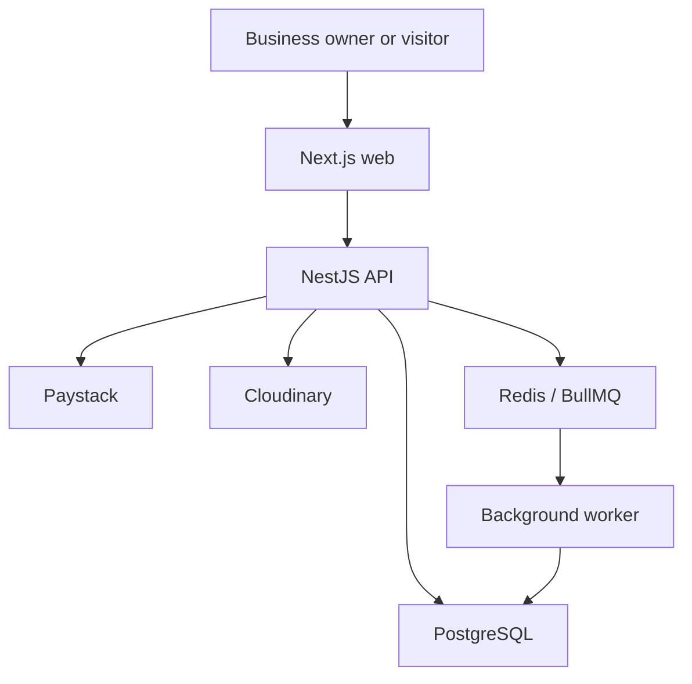

# Architecture

## Shape

One shared PostgreSQL database; each Business is a tenant. NestJS is a modular monolith. Next.js serves marketing, account and private business pages. A persistent worker is planned for analytics and durable event processing.

## Module responsibilities

Auth handles identity/session, Business handles ownership/profile, Product and Service handle catalogue rules, Website handles structured configuration, CRM handles enquiries, Subscription handles billing and entitlement.
Planned modules: media, analytics, operational admin and durable jobs. Their data models are not proof that modules exist.

## Private request

Cookie/JWT authentication → resolve actor → verify business ownership/role → validate DTO → service policy → parent-scoped repository query → explicit response mapping.
An opaque UUID does not confer authorization. Nested IDs must belong to the authorized parent.

## Public read

Resolve canonical business slug → deny deleted/unpublished/ineligible business using current server time → select public profile/theme/content/catalogue fields → render with escaped text and safe media URLs.
Use one entitlement function across profile, catalogue, website config, SEO/sitemap, media access where applicable, and contact submission.
Owner preview uses an authenticated route and must not be cached as public.

## Saving content

Validate complete section set → verify every existing ID belongs to this website → reject duplicates/unsupported types → transactional diff/order write → commit revision → invalidate public projection.
No deletion before full validation. Do not hold database transactions open during provider network calls.

## Async flows

Payment event: verify raw signature → durable inbox row → acknowledge → worker/provider verification → atomic idempotent fulfilment.
Analytics: bounded public payload → rate limit/sampling → queue → worker batch insert/aggregate → tenant-scoped read.
These inbox/worker flows remain implementation tasks.

## Failures

Database unavailable: bounded 503 and visible UI retry, not empty success.
Redis unavailable: dashboard CRUD must remain available; analytics may drop with an explicit metric; payment events require durable DB receipt or a retryable error.
Paystack unavailable: leave payment pending; reconcile later. Never grant access speculatively.
Public cache cannot bypass fresh unpublish/suspension/expiry checks. Start without full-page tenant caching until that invariant is proven.
